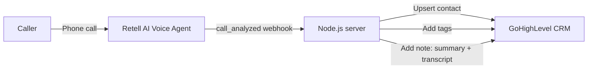

# 📞 Retell AI → GoHighLevel (GHL) Integration

> Automatically sync every **Retell AI voice agent** call into **GoHighLevel CRM** — contacts, tags, AI call summaries and full transcripts.


If you use **Retell AI** for AI receptionists, inbound lead qualification or outbound calling, and **GoHighLevel** as your CRM, this small webhook server connects the two so your team sees every AI call inside GHL — without Zapier or manual copy-paste.

## ✨ What it does

When Retell AI finishes analyzing a call (`call_analyzed` event), the server:

1. ✅ **Verifies** the webhook signature (`x-retell-signature`) so only Retell can call it
2. 👤 **Creates or updates the contact** in GoHighLevel (upsert by phone/email)
3. 🏷️ **Adds tags** — default tags, caller sentiment (e.g. `sentiment-positive`) and any custom tags you pass as dynamic variables
4. 📝 **Adds a note** with the AI call summary, sentiment, extracted data, recording link and full transcript

## 🧠 How it works



## 🚀 Quick start

**Requirements:** Node.js 18+, a Retell AI account, and a GoHighLevel sub-account with a **Private Integration** token.

```bash
git clone https://github.com/adarsh0008/retell-ai-gohighlevel-integration.git
cd retell-ai-gohighlevel-integration
npm install
cp .env.example .env   # then fill in your keys
npm start
```

### 1. Get your GoHighLevel credentials
- In your GHL sub-account go to **Settings → Private Integrations** and create a token with `contacts.write` and `contacts.readonly` scopes.
- Copy your **Location ID** from **Settings → Business Profile**.

### 2. Point Retell AI to your server
- Deploy the server (Render, Railway, a VPS, etc.) or expose it locally with a tunnel.
- In the Retell AI dashboard, set your agent's **webhook URL** to:
  `https://your-domain.com/webhooks/retell`

### 3. (Optional) Pass caller details from your agent
If your Retell agent collects details using **post-call analysis** (e.g. `first_name`, `last_name`, `email`), they are automatically mapped to the GHL contact. You can also pass a `tags` dynamic variable (comma-separated) to add campaign-specific tags.

## ⚙️ Environment variables

| Variable | Description |
|---|---|
| `RETELL_API_KEY` | Your Retell AI API key (used to verify webhook signatures) |
| `GHL_PRIVATE_TOKEN` | GoHighLevel Private Integration token |
| `GHL_LOCATION_ID` | GoHighLevel sub-account (location) ID |
| `GHL_DEFAULT_TAGS` | Tags added to every synced contact (default: `ai-call,retell-ai`) |
| `PORT` | Server port (default: `3000`) |

## 🧩 Ideas to extend

- Create an **opportunity** in a GHL pipeline when the AI books an appointment
- Trigger a **GHL workflow** based on the tags added
- Send an **SMS follow-up** after missed or unsuccessful calls
- Store calls in a database for reporting dashboards

## 👨‍💻 Need a custom Retell AI or GoHighLevel solution?

I'm **Adarsh Shukla**, a **GoHighLevel developer and AI automation expert** with 11+ years of experience. I build **AI voice agents (Retell AI)**, **GHL automations**, **n8n workflows** and **RAG chatbots** for agencies and businesses.

[](mailto:adarshlkj@gmail.com)
[](https://github.com/adarsh0008)

---

⭐ If this helped you, please **star the repo** — it helps others find it!
